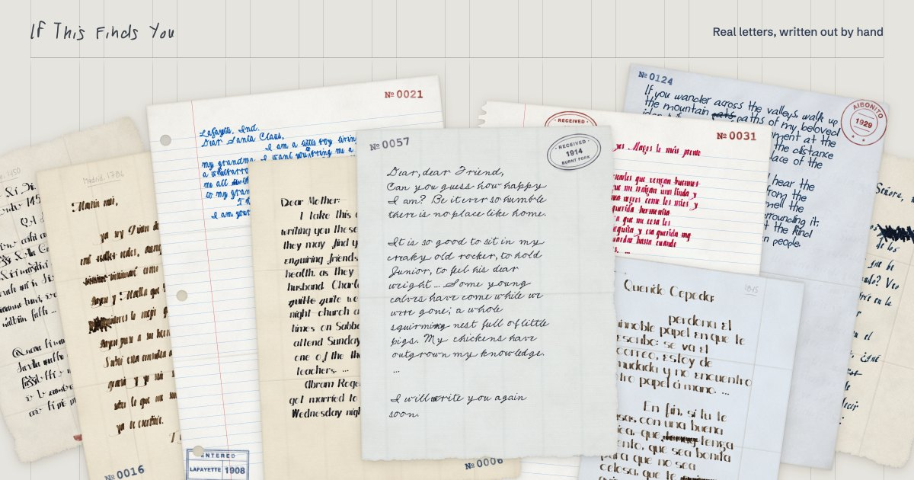
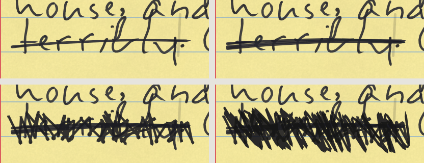

# If This Finds You

Real letters by ordinary people, written out by hand by writers who never existed.

**[ifthisfindsyou.app](https://ifthisfindsyou.app)** · [The writing interaction](#the-writing-interaction) ·
[Run it](#run-it-on-your-computer) · [What's in the code](#whats-in-the-code) · [Contributing](CONTRIBUTING.md) ·
[Discussions](https://github.com/rafaelcespedes/if-this-finds-you/discussions)



## What it is

123 real letters in 14 languages, written between 1395 and 1929, mostly by people known only because their letter
survived: emigrants writing home, settlers in Liberia, children writing to Santa Claus and the Three Kings, families
keeping in touch. About one in six is by a famous writer. Every letter is in the language it was written in, and its
page names its source.

Each letter is written out live, stroke by stroke, in the hand of a fictional writer. The words are the original
writer's. The handwriting belongs to someone who never existed, and *Bring another letter* brings the next letter in
a new hand. You can write a reply, or a letter of your own, straight onto the paper. Changes behave like ink: deleting
crosses a word out, a retyped letter goes over the old one, and an insertion goes in with a caret.

Every hand can be downloaded as a font, free, under the SIL Open Font License.

It's a lab experiment by Rafael Cespedes, a designer. It's free, and there's nothing to sell.

## What you can do on the site

- **Read a real letter, written out live.** The desk opens on a letter in a hand that suits it. *Bring another letter*
  (or R) brings the next one in a new hand; *Change writer* keeps the letter and changes the hand, and *Similar* finds a
  close one. Beside the letter is its record: who wrote it, to whom, where, when, and the source it came from.
- **Write your own letter, or a reply.** Click the paper and type. On a found letter, typing starts a reply on a fresh
  sheet, with their letter beside it. Write *In ink* (the default: mistakes are crossed out, never erased), *In pencil*
  (it rubs out) or as a *Fair copy*. ⌘U underlines by hand, ⌘B presses harder, ⌘↩ adds a P.S., and you can sign it.
- **Choose the writing materials.** 7 papers in 19 kinds, 8 pens with three tips and 9 inks, and sliders for neatness,
  hurry, size, pressure, slant, mistakes and more. Writers can be schooled in any of 13 traditions, joined or print.
- **Share it.** A link that replays the writing for whoever opens it, an image, an MP4 video or an animated GIF.
- **Keep it.** Up to six letters are kept on your device under *My letters*. Nothing is sent anywhere.
- **Browse the library.** [All letters](https://ifthisfindsyou.app/letters): a canvas you can drag, or a list by year,
  place or writer, with search and a timeline. Each letter has its full record and how to cite it. It works offline
  after one visit.
- **Download any hand as a font.** [Fonts](https://ifthisfindsyou.app/fonts): every row is a real font, built in your
  browser. *Download font* gives the `.otf` and `.ttf` with their licence and credits, and *Write with it* opens the
  desk in that hand.
- **Try the writing app.** [ifthisfindsyou.app/notes](https://ifthisfindsyou.app/notes), a work in progress: write
  with a generated hand the way you'd use a font in Notes. Notes kept in your browser, the writer as the font menu,
  titles, lists and checklists written by hand, and In ink or Clean.

It works on phones and computers, and it was built for keyboards and screen readers as well as a mouse.

## The writing interaction

Type on the paper and it behaves like ink. The pen writes a few letters behind you, so a typo you catch in time
disappears cleanly. Once it's written, Backspace crosses it out instead, and on the writing page, pressing again
crosses it out harder, down to a scribble. A retyped letter goes over the old one, and an afterthought goes above the
line with a caret. Nothing is ever erased.



Try it on **[ifthisfindsyou.app/notes](https://ifthisfindsyou.app/notes)**, a small writing app built on it (a work in
progress). How it works, where each piece lives, the numbers to play with, and what's still open:
**[docs/WRITING.md](docs/WRITING.md)**. To make a video of it for a post, there's an
**[X post template](x-post-template/)**. Design engineers, take a stab at it.

## Run it on your computer

You need [Node.js](https://nodejs.org) 24.

```bash
cd app && npm install && npm run dev
```

Then open `http://127.0.0.1:5173` in your browser (`/notes` for the notes app). `npm run build` makes the production
site in `app/dist/`. To try it on your phone, run `npm run dev -- --host` and open the address it prints.

The engine also has a plain test bench with every control:

```bash
python3 tools/serve.py 8765
```

Then open `http://127.0.0.1:8765/lab/index.html` in your browser. Any static server at the project's top folder works
too; the lab loads the engine straight from `../engine`, with nothing to install.

Each part installs on its own: `app/`, `tools/smoke`, `tools/fonts` and `x-post-template/`. The engine and the lab need
no install.

## What's in the code

- **The handwriting engine** (`engine/`). Plain JavaScript with no build step, so it runs the same in a browser and in
  Node. A seed becomes a writer (`makeHand`) schooled in one of 13 traditions; pens and inks (`PENS`, `INKS`) turn its
  strokes into ink; `layout` sets a page; `renderSVG` and `renderCanvas` draw it; `createPen` and `paintPen` write it out
  stroke by stroke; `geometry` gives the caret for editing. `engine/index.js` lists everything it exports.
- **The font builder** (`engine/fontbuild.js`). Any hand as an `.otf` and a `.ttf`: 319 characters, four or five
  versions of each letter that cycle as you type. The same hand always gives the same font. [docs/FONTS.md](docs/FONTS.md)
- **Typing that behaves like ink** (`engine/sheet.js`, `engine/inklog.js`, `engine/marks.js`). The planner, the pen,
  the corrections and the ink log. [docs/WRITING.md](docs/WRITING.md)
- **The lab** (`lab/`). A test bench with every control: new hands, writing speed, fonts, pens and letter shapes.
- **The checks** (`tools/qa/`, `tools/smoke/`). The engine compared with the version before, a full review of speed,
  variety and feel, the ink tests, and the site opened in a real browser.
- **The tracing pipeline** (`tools/trace/`, Python). How letter shapes are traced from copybook scans, with every source.
- **The X post template** (`x-post-template/`). A square video of the writing for a post, drawn by the same engine.

## How it works

### The handwriting engine

`engine/` is plain JavaScript modules, with no build step, so it runs the same in a browser and in Node.

- **A seed becomes a writer.** The seed picks a tradition, then the writer's own letter forms, slant, size, spacing,
  rhythm and habits, including the mistakes they make and how they correct them. The same seed, settings and text
  always give the same page.
- **Thirteen traditions.** Ten joined hands and three print hands. Their letters were traced as single-line
  skeletons from copybooks printed between 1522 and 1917 (Arrighi, Strick, Palomares, Brandt, Spencer, Prószyński,
  Palmer, Sütterlin), from Dr. A. V. Hershey's stroke fonts, and from the handwriting of present-day volunteers in
  Québec and France. Writers can be schooled in one tradition and influenced by another.
- **Variation is layered.** Writer, page, line, word, letter and stroke each vary a little, and the variations are
  linked, the way a real hand drifts. Lines wander off the rules, sizes change, and some hands are untidy. Only bugs
  get fixed, never taste.
- **Ink is physical.** Each pen turns the skeleton into an outline. Ink follows the pen's speed and pressure,
  darkens where strokes cross, and once written it stays put.

Every letter form carries its source, so the credits can always be traced back. The tracing pipeline and its
sources are in `tools/trace/`.

### The fonts

`engine/fontbuild.js` turns any hand into an `.otf` and a `.ttf` in the browser, in about a second. Each font covers
the 319 characters of Google Fonts' Latin Core set and keeps four or five versions of each letter (four for joined
hands, five for print), which it cycles as you type, so two neighbours never match. Joined hands also carry word
starts, word ends and the writer's own pen lifts. A font repeats where the page doesn't, and every download says so.
Details and limits: [docs/FONTS.md](docs/FONTS.md).

### The letters

`content/sample-texts.json` holds the collection, with each letter's source, its writer as far as the source says,
and why it's free to use. Nothing is invented, and where a source is silent, so is the letter's page. Every letter
switched on must be in the public domain in both the US and the EU, and `node content/check-texts.mjs` checks the
rules and the collection's targets. The full notes are in [content/SAMPLE-TEXTS.md](content/SAMPLE-TEXTS.md).

## What's where

| Folder | What's in it |
|---|---|
| `app/` | The site: React, Vite and Tailwind |
| `engine/` | The handwriting engine and the font builder |
| `content/` | The letters, their sources and the checker |
| `lab/` | The engine's test bench |
| `tools/` | Engine QA, the smoke test, the tracing pipeline, the font pack builder and the share image |
| `brand/` | The wordmark, written by the engine |
| `docs/` | Principles, decisions, voice, architecture and research |
| `x-post-template/` | A video of the writing for a post on X, made with Remotion |
| `.github/` | The checks that run on every change, and the issue forms |

Every push and pull request runs two checks on GitHub: the site is built and opened in a browser, and the engine's
output is compared with the version before. The site only updates once both pass, and a fuller review of the engine
runs every night. [docs/CHECKS.md](docs/CHECKS.md) explains them.

## Credits

- The Hershey fonts were originally created by Dr. A. V. Hershey while working at the U.S. National Bureau of
  Standards. The format of the font data was originally created by James Hurt, Cognition, Inc.
- The copybooks, all in the public domain: Ludovico degli Arrighi (Rome, 1522–24), Maria Strick (Rotterdam, 1618),
  Francisco Javier de Santiago Palomares (Madrid, 1776), Brandt (Christiania, 1849), Platt Rogers Spencer and the
  Spencerian authors (New York, 1866), Konrad Prószyński (Warsaw, 1906), Austin Norman Palmer (New York, 1915) and
  Ludwig Sütterlin (Berlin, 1917). The libraries whose scans we traced are named in
  [tools/trace/SOURCES.md](tools/trace/SOURCES.md).
- Present-day handwriting: *Copiste d'un jour*, Bibliothèque et Archives nationales du Québec (2024), and
  *CREMMA-Wikipedia* (HTR-United, 2022–23), both under CC BY 4.0. The volunteers' letters were traced and redrawn;
  their texts are not used.
- The letters: every source is credited in [content/SAMPLE-TEXTS.md](content/SAMPLE-TEXTS.md) and on each letter's
  page.

## Licences

The code is under the MIT License ([LICENSE](LICENSE)). The fonts the site makes are under the SIL Open Font License
1.1. The letters are in the public domain, apart from two transcriptions under open licences. Which licence covers
which folder, and what each one asks of you: [LICENSES.md](LICENSES.md). The X post template's code is MIT too, but it
runs on [Remotion](https://www.remotion.dev), which has its own licence: free for individuals and companies of up to
three people.

## Contributing

Contributions of every size are welcome: fixes, experiments, ideas, recordings of something that felt wrong, and
corrections to a letter (the collection doesn't take new letters for now).

- Start with [CONTRIBUTING.md](CONTRIBUTING.md): where to start, ways to help and how to set up.
- Pick up an [open issue](https://github.com/rafaelcespedes/if-this-finds-you/issues), or
  [one about the writing](https://github.com/rafaelcespedes/if-this-finds-you/issues?q=is%3Aopen+label%3Awriting).
- Show what you made in [Show and tell](https://github.com/rafaelcespedes/if-this-finds-you/discussions/categories/show-and-tell),
  and ask anything in [Q&A](https://github.com/rafaelcespedes/if-this-finds-you/discussions/categories/q-a).

Please read the [code of conduct](CODE_OF_CONDUCT.md). Security problems go privately: [SECURITY.md](SECURITY.md).
