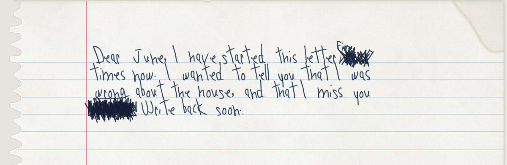
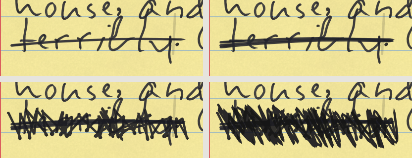

# The writing interaction

Typing that behaves like ink. You edit like a computer user, and the writer corrects like a person: a word you
take back is crossed out, a wrong letter is written over, an afterthought goes above the line with a caret. Nothing
already written ever moves, and nothing is erased.



Everything that makes it work is in this repository, under the MIT License. If you're a design engineer and want to
take it further, or take it somewhere else, this page is the way in.

## Try it

On the site: **[ifthisfindsyou.app/write](https://ifthisfindsyou.app/write)**, a small writing app built on this
interaction: write with a generated hand the way you'd write with a font in Notes. It's a work in progress, where new
ideas land first. The home page, [ifthisfindsyou.app](https://ifthisfindsyou.app), has the same writing on the letter
desk: click the letter and start typing.

On your computer (you need [Node.js](https://nodejs.org) 24):

```bash
cd app && npm install && npm run dev
```

Then open `http://127.0.0.1:5173/write` for the writing page, or `http://127.0.0.1:5173/` for the letter desk.

Want a video of it for a post? The [X post template](../x-post-template/) makes the square demo video, keyboard and
all, with the real engine, and lets you change what's typed, the writer and the paper.

## What it does

| You | The writer |
|---|---|
| Type | Writes it out by hand, a few letters behind you. No two letters come out the same. |
| Backspace before the pen gets there | It's gone, cleanly. You changed your mind before the ink touched the paper. |
| Backspace once it's ink | The pen hovers for a moment, then crosses the word out, or writes the right letter over the wrong one. |
| Backspace again on a crossed-out word, or hold it down | Crosses it out harder: a heavier line, then a scribble, then inked out (on `/write` for now). On a phone, a held key is read from how fast the deletions come. |
| Select and delete | Strikes it through, in this writer's own way (a line, two lines, a wave, loops or a scribble). |
| Select and type | Strikes the old words and writes the new ones above them. |
| Type in the middle of a line | Adds it above the line, with a caret. |
| Space inside a word, Enter in the middle | A `/` between the words, a `//` for a new paragraph. |
| ⌘B, ⌘U | Goes over the words again; underlines them by hand (twice for a double underline). With nothing selected, ⌘B presses harder from here on. |
| ⌘I | What you type next leans in. |
| `# `, `## ` at the start of a line | A title or a heading, set out the way this writer does it: underlined once or twice, in capitals, or centred. |
| `- `, `1. `, `[] ` | A list with the writer's own bullet, numbers that never renumber, or a checklist with hand-drawn boxes. Click a box and the pen ticks it; unticked in ink, the tick is scribbled out. |
| ⇧⌘E | A felt highlighter swipe, under the ink. |
| Select and delete a whole page | Crossed out where it stands, like any other deletion. Undo on the dry ink writes *stet* and brings it back. |
| ⌘Z | Lifts the ink only while it's wet: fresh ink looks a little deeper until it dries, 2 to 6 seconds depending on the pen. On a dry crossing-out, writes *stet* in the margin with dots under the word, and the word counts again. |
| Type fast, or slowly | A burst comes out a little hastier; slow, careful typing a little tidier. The same writer, in a different mood. |

Crossing a word out again, one press at a time:



## The writing app

`/write` treats the hand like a font in a notes app:

- **Notes, kept in the browser.** Every note is kept on the device as you write (IndexedDB, one record per note, so two
  tabs never write over each other). The library lists them the way Notes does: Pinned, Today, Yesterday, then by
  month, each with its real first sheet in its own hand. A note thrown away waits 30 days.
- **The writer is the font menu.** The writer's name, written in their own hand, opens it: your own words written by
  other writers (pick one and the note is written again in their hand), then the pen, the ink, the paper and the size.
- **In ink or Clean.** In ink (the default) nothing is erased. Clean edits freely, like any font: the words are laid out
  again as you go, with no slips of the writer's own. A note can switch either way; Clean tidies the crossings-out
  away, and back in ink it carries on in ink from there. *Make a fair copy* writes a clean copy on a new note and keeps
  the draft.
- **Formatting by hand.** The words people know from Notes, done the way a hand does them (`engine/format.js`,
  `engine/format-marks.js`): what's typed next changes at once (pressed harder, leaning), marks on written words are
  made by the pen going back (going over, underlining, ticking, highlighting), and a line already in ink keeps its
  style, because ink can't be re-set.
- **The page is the app.** The toolbar floats over the desk, never over the paper, and steps back while you write. ⌘/
  lists every shortcut.

## How it works

1. **Input stays native.** A transparent textarea sits over the paper (`app/src/components/PaperEditor.tsx`), so the
   browser keeps doing what it does well: input methods, autocorrect, dictation, selection, screen readers. Each change
   is read as a diff of the old and new text, an `Edit { at, del, ins, kind }` (`app/src/lib/edits.ts`,
   `app/src/hooks/useEditInput.ts`). The edit is your intent, not what the page does.
2. **A planner decides what this writer would do.** `plan()` in `engine/sheet.js` turns an edit into events on paper:
   strike, write over, insert above, a split mark, a fresh sheet. It keeps a small *view* of what's in flight: text
   typed but not yet written (the tail), an insertion being typed (mid), and a deletion the pen is hovering over
   (pending).
3. **The pen is slower than your fingers, and that's the grace.** `penStep()` releases text at handwriting speed:
   about two characters a second, up to four times faster when it's far behind, holding back the last two characters
   until you pause for 700 ms. Whatever it hasn't reached can still be deleted cleanly. This lag is the "timer".
4. **The source of truth is an append-only ink log.** `engine/inklog.js`: `write`, `break`, `strike`, `over`,
   `insert`, `mark`, `underline`, `pen`, `move`, `sheet`. What the letter says is derived from the log, never stored.
   A whole letter fits in a share link.
5. **Corrections are drawn from the writer's habits.** `engine/marks.js` draws every mark from one writer's
   temperament (`fixHabits`): how tidy they are, how they strike a word, how they scribble (tight zig-zags, angry
   blackouts, loopy coils), how hard they press. Each mark is placed once, on the letters it covers.
6. **Crossing out again.** `again()` in `engine/sheet.js` finds the struck run at the caret and adds one more pass, a
   level harder: a heavier strike, then the writer's own scribble with the word still showing through, then inked
   out. Held down, `/write` climbs one level every 700 ms, about as long as the hand takes to draw one.
7. **Drawing.** `app/src/components/LiveSheets.tsx` patches the page word by word as the log grows, and
   `engine/animate.js` (`createPen`, `paintPen`) draws the strokes in writing order. Letters the pen hasn't reached
   show as faint graphite "thoughts".
8. **The hand keeps your tempo.** `engine/tempo.js` measures each word against your own typing speed, and the `write`
   event carries it (`haste`, −2 to 2): a hasty word leans and stretches a little, a careful one tidies up. Absent means
   the usual hand, so older letters replay as they were.
9. **Stet.** ⌘Z on a dry crossing-out adds a `stet` event: dots under the word, *stet* in the margin in the writer's own
   letters, and the word counts again in the text (`[restored: …]` in the transcription).
10. **Deterministic.** The same log gives the same page, byte for byte, live or replayed. Every mark is seeded by its
   event's place in the log, so each one is different and the page never changes after the fact.
   `tools/qa/ink.mjs` checks it, with random editing sessions and a check that nothing already on paper moves.

## Where things are

| File | What it does |
|---|---|
| `engine/sheet.js` | The planner (`plan`), the pen (`penStep`), crossing out again (`again`), replay, undo of wet ink (`dropLast`) |
| `engine/inklog.js` | The ink log: events, the text it reads as, the compact form and share links |
| `engine/marks.js` | Strikes, scribbles, overwrites, carets and underlines, from each writer's habits |
| `engine/animate.js` | The pen that draws the strokes in order |
| `app/src/lib/ink.ts` | `InkSession`: the bridge between the page and the engine |
| `app/src/components/PaperEditor.tsx` | The textarea over the paper, the caret, selection and keys |
| `app/src/components/LiveSheets.tsx` | The live page, patched word by word |
| `engine/tempo.js` | Your typing tempo, word by word, as a little haste or care in the hand |
| `engine/format.js`, `engine/format-marks.js` | Formatting by hand: leaning, pressing harder, titles and headings, lists and checklists, the highlighter |
| `app/src/write/` | The writing app: `WriteApp.tsx` (the frame), `Desk.tsx` (a note in ink), `CleanDesk.tsx` (a note in Clean), `Library.tsx`, `WriterPanel.tsx` (the font menu), `FormatPanel.tsx` (Aa), `notes.ts` (keeping notes), `hold.ts` (a held Backspace on any keyboard) |
| `tools/qa/ink.mjs`, `again.mjs`, `tempo.mjs`, `stet.mjs`, `hold.mjs`, `format.mjs` | The checks (they run on every change) |
| `x-post-template/` | A video of the writing for a post (Remotion), drawn by the same engine |

The thinking behind it, with prior art and the studies it draws on:
[docs/research/writing-experience.md](research/writing-experience.md) (the interaction model and the ink log),
[human-feel.md](research/human-feel.md), [editor-ux.md](research/editor-ux.md) and
[input-quirks.md](research/input-quirks.md) (what browsers and phones do to typing).

## The numbers to play with

| What | Where | Now |
|---|---|---|
| Pen speed | `penStep` in `engine/sheet.js` | About 2 characters a second, up to 4× when far behind |
| Letters held back while you type | `penStep` (`forgiving`) | The last 2, until 700 ms without a key |
| The pen hovering over a deletion | `penStep` (`pending`) | Until the next word starts, or 1.2 s |
| How long ink stays wet | `wetWindow` in `app/src/lib/ink.ts` | By pen, from when the pen lifts: ballpoint 2 s, felt 3 s, gel 4 s, fountain 6 s |
| A held key crossing out again | `AGAIN_EVERY` in `app/src/write/hold.ts` | One level every 700 ms, four levels; on a phone, deletions closer than 150 ms are a held key |
| How much your tempo shows | `engine/tempo.js` | About 5° more lean and 7–16% wider at the fastest, against your own average |
| The drawn pen's pace | `createPen` in `LiveSheets.tsx` (`lag`) | About 1.2 s behind you while you type, done within about 1.5 s of your last key; a paste copied out within 6 s |

## Take a stab at it

Some things we know aren't right yet, and ideas we haven't built. Each has an issue to pick up
([all of them](https://github.com/rafaelcespedes/if-this-finds-you/issues?q=is%3Aopen+label%3Awriting)):

- **Pencilled formatting.** A line already in ink can't be made a title or leaned: the ink is dry. A pencilled note
  in the margin that the fair copy carries out would keep every control meaningful (see `FormatPanel.tsx`).
- **Clean, with everything.** Titles, lists, leaning and the highlighter are written in ink for now; in Clean, only
  underlining and pressing harder.
- **Phones.** Autocorrect replaces whole words after the pen has written them. A held Backspace is now read from how
  fast deletions arrive, which wants checking on real phones.
- **Pauses leave a mark.** Stop mid-sentence and the nib rests on the paper; a dot of ink spreads while you think
  ([#3](https://github.com/rafaelcespedes/if-this-finds-you/issues/3), a good first issue).
- **Running out of room.** The last lines squeeze, then "over" and a new sheet; on a postcard, up the margin
  ([#7](https://github.com/rafaelcespedes/if-this-finds-you/issues/7)).
- **Moving text** with a loop and an arrow instead of cut and paste ([#8](https://github.com/rafaelcespedes/if-this-finds-you/issues/8)).
- **Pencil ghosts.** *In pencil* already rubs out; a real eraser never takes everything, and leaves a ghost
  ([#9](https://github.com/rafaelcespedes/if-this-finds-you/issues/9)).

If you make something with it, I'd love to see it: open an issue or a pull request, or find me on X,
[@rafcespedes](https://x.com/rafcespedes). For anything big, open an issue first so we can talk before you spend the
time ([CONTRIBUTING.md](../CONTRIBUTING.md)).

A few things the engine holds to:

- **Nothing already written moves.** Corrections go on top, above or beside, never in place of.
- **The same log gives the same page.** A change to what the engine draws has to keep replays identical.
- **Real hands are allowed to be ugly.** Bugs get fixed, never taste ([PRINCIPLES.md](PRINCIPLES.md)).

Designed by Rafael Cespedes, built with Claude. The code is under the MIT License: fork it, take it into your own
editor, change everything.
